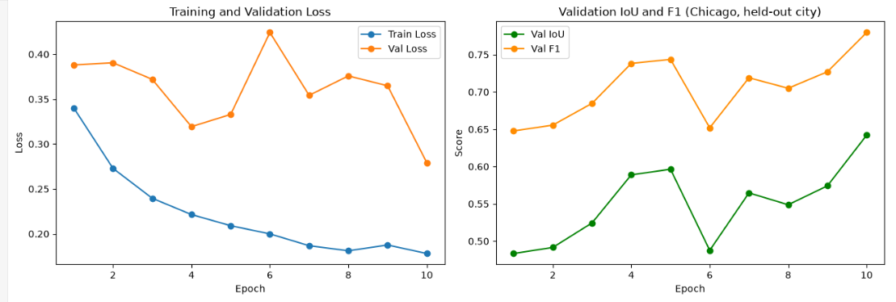
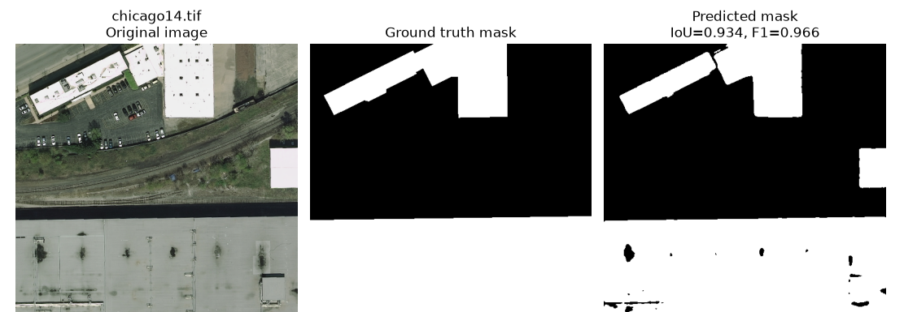
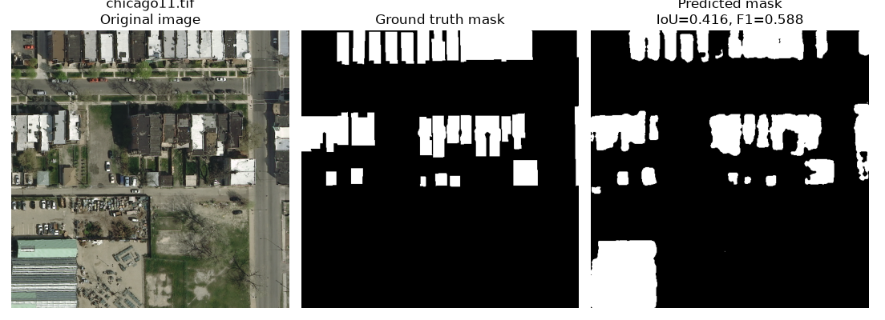

# Building Footprint Segmentation from Aerial Imagery

A binary semantic segmentation pipeline that extracts building footprints from high-resolution aerial photographs, built with a U-Net and evaluated on a city the model never saw during training.

> **Dataset not included.** The Inria Aerial Image Labeling Dataset is large (about 20 GB). Download it from the [official site](https://project.inria.fr/aerialimagelabeling/) and place the extracted `AerialImageDataset` folder next to the notebook (see "How to run" below).

## What this project does

- **Leakage-safe split.** One entire city (Chicago, 36 tiles) is held out for validation and the model trains on the other four cities (144 tiles). Patches are cut only after the split, so no patch can overlap across the train/validation boundary.
- **Efficient data loading.** Each 5000 by 5000 tile is read from disk once per pass and several random 512 by 512 patches are drawn from it, which keeps memory use low and avoids repeated disk reads.
- **Model.** U-Net with an ImageNet-pretrained ResNet34 encoder (about 24.4 million parameters), using the `segmentation-models-pytorch` library.
- **Loss.** Dice plus binary cross entropy to handle class imbalance (buildings cover a minority of pixels). A boundary-weighted variant is also documented as an ablation.
- **Metrics.** IoU and F1/Dice, reported instead of plain pixel accuracy.
- **Hardware.** Trained on an Intel Arc A580 GPU through PyTorch's XPU backend. The notebook falls back to CUDA or CPU automatically.

## Results

Held-out city (Chicago), after 10 epochs:

| Metric | Value |
|---|---|
| IoU | 0.642 |
| F1 / Dice | 0.780 |
| Validation loss | 0.279 |

An ablation with an explicit boundary-weighted loss reached IoU 0.610 (best epoch), slightly below the plain Dice plus BCE run. No random seed was fixed for either run, so part of that gap may be ordinary run-to-run variation.

### Training curves



### Success case (IoU 0.934)

Large, simple, high-contrast buildings are segmented almost exactly.



### Failure case (IoU 0.416)

In dense blocks of small, closely packed houses the model finds the right areas but merges neighboring buildings into one blob, losing the narrow gaps between them.



## Repository contents

| Path | Description |
|---|---|
| `aerial_segmentation.ipynb` | Annotated notebook: data exploration, split, training, metrics, visualization |
| `reports/research_summary_report.pdf` | Written summary of methods, results, and error analysis |
| `figures/` | Figures used in this README |
| `requirements.txt` | Python dependencies |

## How to run

```bash
# 1. Clone this repository
git clone https://github.com/<Nafis-Niaz-Chowdhury>/aerial-building-segmentation.git
cd aerial-building-segmentation

# 2. (Optional) create a virtual environment
python -m venv .venv
.venv\Scripts\activate          # Windows
# source .venv/bin/activate     # macOS / Linux

# 3. Install dependencies
pip install -r requirements.txt
```

4. Download the Inria dataset and extract it so this layout exists:

```
aerial-building-segmentation/
  AerialImageDataset/
    train/
      images/   (austin1.tif, chicago1.tif, ...)
      gt/       (matching masks)
  aerial_segmentation.ipynb
```

5. Launch Jupyter and run all cells (`jupyter notebook`). Full training takes roughly 100 minutes on the hardware above.

Note: the `imagecodecs` package is required because the ground-truth masks use LZW compression.

## Limitations and next steps

- Ground truth for the official Inria test set is not public, so all evaluation uses the labeled training tiles with a custom city-level split.
- Validation metrics were still improving at epoch 10, so longer training would likely help.
- The main weakness is separating small buildings that sit only a few pixels apart.

## License

Add a license of your choice (for example MIT) before sharing publicly. The dataset has its own terms, see the Inria website.
